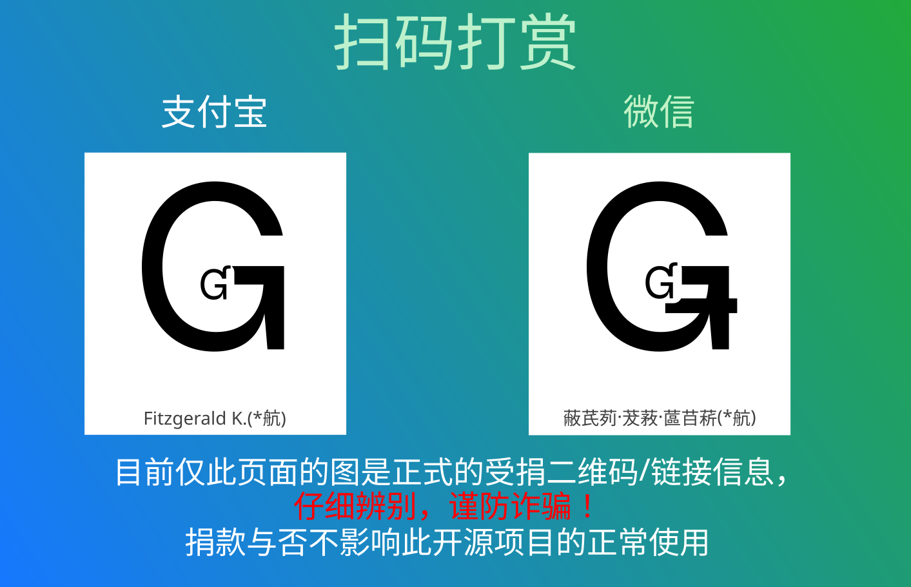

<h1>遍黑體項目（Plangothic Project）</h1>

 

 

> [!CAUTION]
> 
> - 近來發現，包括本字體在內的眾多開源字體在淘寶、小紅書等平臺被不法商家倒賣，違反了 SIL OFL 1.1 中「不得單獨售賣字體檔案」的條款。如您遇到此類店鋪販售本字體，**請不要購買**！您支付的款項**不會**流向作者，您也**無法**獲得任何更新或支援。
> - 如果您希望向所在單位推薦本字體，但法務部門不認可 SIL OFL 1.1 協議的效力、要求提供傳統「授權證明」，建議您放棄使用本字體，改用可開具授權證明的免費商用字體或購買商業版權字體。
> - 近來發現，有第三方將本字體用於訓練 AI（人工智慧）模型，再用該模型生成字體。由於實際訓練資料不明，生成的字體具有一定的法律風險。因此，如您遇到某些聲稱基於本字體或上游字體訓練而成的 AI 字體，**請不要使用**！此字體項目的開發全程堅持不使用任何 AI 技術，各位使用者可放心使用。

## 概述
遍黑體項目以[思源黑體](https://github.com/adobe-fonts/source-han-sans)為基礎，依中國大陸字形標準為中日韓統一表意文字擴展區補充字形。本項目是「遍宇宙家族」的子項目，約於 2020 年 6 月啟動。

## 收錄範圍
本字體主要支援擴展 B 區至擴展 J 區的全部漢字，其他區塊有零星的字元。

## 貢獻者
- 主製作：[Usagixineist](https://github.com/Usagixineist)、[WAAO-SCREAMER](https://github.com/WAAO-SCREAMER)、Nachicraft、Magnetshroom
- 其他技術協助：[0xAA55](https://github.com/0xAA55)、[Baysoftware](https://github.com/yi-bai)、Boris Ivanovich、[Henry Chan](https://github.com/hfhchan)、[Hulenkius](https://github.com/Hulenkius)、[Losketch](https://github.com/Losketch)

還有不少其他曾經向遍黑體項目給予支持、參與製作的人員，也在此對他們表示感謝。

## 授權協議

### 字體檔案（SIL Open Font License 1.1）

字體檔案以 SIL Open Font License 1.1 協議發布。
授權協議的非官方簡體中文譯本可參考 [貓啃網](https://www.maoken.com/ofl)。

#### 您可以：
- 任何個人、團體、組織及企業都可免費將本字體用於商業及非商業用途，無須支付費用、事先通知作者、標明來源或徵得作者許可。
- 可重新散布字體檔案，或將其安裝或嵌入任何軟體或設備。該軟體或設備可再散布或銷售。
- 可修改、擴充字體檔案或轉換其格式。衍生版本**亦須以 SIL Open Font License 發表**，並**嚴禁使用本字體的保留名稱「Plangothic」、「遍黑」**。若僅轉換原字體的格式，仍可使用該保留名稱。

#### 您不可以：
- 將字體檔案本身單獨售賣（字體可作為軟體或設備的一部分進行捆綁銷售，但不能單獨作為商品出售）。
- 將字體檔案中的任何部分以 SIL Open Font License 以外的授權協議發表。
- 其他未在上述項目列出、但違反 SIL Open Font License 的行為。
 
**免責聲明（非協議條款）：**
使用者可在遵守當地法律法規的前提下自由使用。作者不對因使用本字體導致的任何系統損壞或法律糾紛承擔責任。OFL 協議本身已包含免責條款，詳見 [LICENSE-OFL.txt](LICENSE-OFL.txt)。

### 建置與開發程式碼（MIT License）
- 倉庫中的原始碼、指令碼與設定檔以 MIT License 發布，可自由使用、修改、散布，包括商業用途。

---

**重要提醒：**
- 使用本倉庫中的任何內容，即視為同意遵守相應協議，詳細的條款內容請參見[LICENSE-OFL.txt](LICENSE-OFL.txt)和[LICENSE-MIT.txt](LICENSE-MIT.txt)。
- 本字體為可免費商用的字體，並以 OFL 協議發布，任何人均可免費使用、修改和散布。作者從未授權任何個人或機構**單獨售賣本字體檔案**。若您在獲取字體檔案時被要求支付費用，相關行為可能存在誤導或詐騙風險，請務必謹慎。需要說明的是，OFL 協議允許將字體作為其他付費軟體或硬體的一部分進行捆綁散布。
- 作者不行使、未能及時行使或未充分行使授權協議中所享有的合法權利，不視為放棄該權利，也不影響作者在將來行使該權利。
- 本倉庫中的所有內容不包含任何政治意圖、隱喻及目的，與一切政治活動無關。作者不承擔您使用該字體所產生的任何連帶法律責任。

## 常見問題
### 1. 為什麼遍黑體是兩個字體檔案？
- 因為一個字體所能容納的字形數量有限（65,535 個），而表意文字的總數量遠大於這個值。
### 2. 為什麼本項目收錄了少量基本區及擴展 A 區的漢字？
- 因為本項目的宗旨是「基於[思源黑體](https://github.com/adobe-fonts/source-han-sans)進行的補充」，如需顯示基本區和擴展 A 區的表意文字，直接使用思源黑體即可。本項目中所包含的零星的基本區和擴展 A 區的表意文字均為在 Unicode 內**有字形改動或者不符合本項目宗旨**的表意文字。本項目在添加這些表意文字之前均已與其他主流字體和 Unicode 碼表內字形進行過比對。
### 3. 未來是否會做包含其他字重（或其他地區字形）的版本？
- 因為本項目工程量過於龐大，所以不會有此打算。若您有類似想法，可自行製作符合自身需求的衍生字體。
### 4. 為什麼本項目的字體不支援複雜文種排版（Complex Text Layout，CTL）或表意文字異體序列（Ideographic Variation Sequence，IVS）？
- 本項目的字體定位為用於顯示字形的工具字體，類似於[Unifont](https://unifoundry.com/unifont)。準確排版複雜文種，或利用表意文字異體序列顯示其他地區字形，均**不在**本項目的涵蓋範圍內。若您有類似想法，可自行製作符合自身需求的衍生字體。
### 5. 手機或軟體可以直接使用本項目的 TTC 字體（由多套 TrueType 字體組成的集合）嗎？直接安裝在手機上後能顯示所有字形嗎？這些相容性問題是否會出現在所有軟體平台，還是只限於特定平台？
- 本項目的 TTC 字體可以在 Windows 上正常使用。直接在手機上安裝 TTC 檔案時，只能使用集合中的一套字體（通常是 P1），因此無法同時顯示集合中的全部字形。在軟體中使用時，可能需要額外設定才能顯示 TTC 中的全部字形。各平台對 TTC 的相容性可能不同，多數情況下需要額外步驟。
### 6. 各個發行版本有什麼區別？
- **Super 版本**：包含所有格式的字體檔案，檔案體積較大。
- **Static 版本**：包含 P1 和 P2 兩個獨立的 TTF 字體檔案，以及一個 TTC 檔案。
- **OTF 版本**：OpenType 格式的字體檔案，以及一個 TTC／OTC 檔案。
- **Web 版本**：WOFF2 格式的網頁字體檔案。
- **單獨的 TTF 檔案**：直接取自 Static 版本，方便單獨下載使用。

**壓縮格式**：`.7z` 與 `.zip` 壓縮檔的內容相同，差別僅在壓縮率。`.7z` 檔案較小，但可能需要第三方解壓縮軟體。`.zip` 檔案稍大，但系統已有內建支援。

<b>附：在 Windows 安裝遍黑體並設為全系統的後備字體：</b>

**基礎安裝方法：**

1. **安裝字體**：下載 TrueType 字體，選擇兩個獨立的 TTF 檔案或單一 TTC 檔案，按滑鼠右鍵並選擇「為所有使用者安裝」（需要管理員權限）。
2. **設定字體後備**：按兩下執行 `registry/Plangothic-Install.reg`（需要管理員權限）。
3. **重新登入**：登出再重新登入 Windows 帳戶，讓設定生效。
4. **卸載**：如要卸載字體，可刪除已安裝的字體檔案。如要移除字體後備設定，可執行 `registry/Plangothic-Uninstall.reg`。

> **進階用法和詳細說明**：請參閱 [進階設定說明](./registry/Experimental/README.md)

## 支持我們
「不積跬步，無以至千里。」遍黑體項目製作難度大，製作時間長，若願意支持我們，在此致以誠摯感謝！您的捐助可以幫助遍黑體項目繼續發展。您還可以通過其他方式做出貢獻，如幫助檢查錯誤字形，對不美觀字形提出改進意見等。

在您捐助之前請務必注意以下幾點：
- 捐款前請務必仔細確認付款帳戶（支付寶：Fitzgerald K.、微信：蔽芪茢·茇䓮·蓲䒤菥。如用戶名有改動，則第一時間會做出更正），我們無法承擔您受騙的損失。
- 現時只有這一個頁面是正式的受捐頁面。如果您在其它地方看到此項目的捐款連結，請立刻對其進行舉報，必要時可協助相關司法機關。
- 您向本項目捐助，即默認表明您贊同我們的理念，並願意以此種方式支持我們的發展。捐助者提出的意見會被認真考慮，但捐款再多也沒有權利以個人意志改變本項目的宗旨和公益性質。
- 捐助後如願意，可留言寫明您的捐款時間和金額，感謝您對本項目的支持。
- 所有捐助資金均會逐一記錄，並將全部用於該項目的技術支援等開銷，不會被私用。

## 聯絡方式
使用本字體時如有任何問題或建議，歡迎回報。您可在本項目提出 issue（嚴禁提交無關內容），也可透過以下方式聯絡我們：
- GitHub: https://github.com/Fitzgerald-Porthmouth-Koenigsegg
- Twitter: https://twitter.com/Fitzgerald_P_K_/
- 郵箱: 374601620@qq.com（備用郵箱：fitzgeraldkoenigsegg@gmail.com）
- QQ: 374601620

## 其他說明
1. 任何人都可以參與到遍黑體項目的製作中，但需確保您對地區字形、字形美觀、軟體使用、Unicode 等方面有一定的基礎，可加入本項目的 QQ 群 [1135661191](http://qm.qq.com/cgi-bin/qm/qr?_wv=1027&k=HvSdPx6z78suzTz51M3xGe-gENeaa1yc&authKey=eHjDZI54yDVbhyFjQqA2ImtV35LFy%2Fit8EuAzVDscVPcACE23L0hT314LiU9ey2%2F&noverify=0&group_code=1135661191) 討論及詢問詳情。
2. 本項目長期招賢納士，您可以動用自己的一份力，讓身邊更多的人瞭解該企劃。我們也歡迎字體製作方面的技術人才，歡迎大家繼續完善該項目，您可以透過上面的方式聯絡作者。遍黑體項目的發展離不開你們的宣傳和鼓勵。
3. 本項目成員並不是專業的字體設計師，所以會導致字體的字形結構可能不甚美觀，補字與原版相比可能略有違和感。此外由於成員的時間與精力有限，項目並沒有多餘的時間精修，部分漢字的部件拼接會很生硬，因此作者無法保證字體本身數據的準確性及預期呈現效果在您的設備是否能夠完美複現，作者不對本字體作任何明示或暗示的保證，亦不承擔您使用該字體所產生的任何索賠、損害或可歸責事由而來的任何責任。
4. 本字體包含的部分國標字形**未完全遵循**[Unicode官方碼表文件](https://www.unicode.org/charts/)中所展示的字形，十分介意者請勿使用。
5. 本項目部分或全部借用或參考了其他工具或開源字體項目，主要包括：
    - [思源黑體](https://github.com/adobe-fonts/source-han-sans)。
    - Noto系列裡的其他字體。
    - [oppekebekkanko](https://oppekebekkanko.booth.pm/)所開發的[すきまゴシック（Sukima Gothic、隙間黑體）](https://oppekebekkanko.booth.pm/items/2117070)。
    - [昭源黑體](https://github.com/chiron-fonts/chiron-hei-hk)。
    - [奈白不弍](https://github.com/Buernia)所開發的[煮豆黑體](https://github.com/Buernia/Zhudou-Sans)。
    - [白易](https://github.com/yi-bai)所開發的[字統網](https://zi.tools)。
    - [Gothic Nguyen（阮黑體）](https://github.com/TKYKmori/Gothic-Nguyen)。
    - [Unicode官方碼表文件](https://www.unicode.org/charts/)。
    - [Unihan數據庫](https://www.unicode.org/Public/18.0.0/ucd/Unihan.zip)。
    - [ぼんのう堂](https://shokaki.booth.pm)所開發的[しょかき変体仮名ゴチック（Shokaki Hentaigana Gothic）](https://shokaki.booth.pm/items/5633978)。
    - [Unicodia](https://github.com/Mercury13/unicodia/)。
    - [尚古黑體](https://github.com/GuiWonder/Shanggu)。
    - [寒蟬端黑體](https://github.com/Warren2060/ChillDuanSans)。
    - [源萃黑體](https://genzui.mkpo.li/sans)。

## 關於「遍宇宙家族」（Planiverse）
該字體家族由Fitzgerald在2023年12月創設，現時涵蓋了以下的幾個子字體項目：
1. **Plangothic Project（遍黑體項目）**：基於思源黑體，並以中國大陸字形為標準的對中日韓越統一表意文字擴展區進行字形補充的項目。
    - **項目狀態**：持續跟進 Unicode 最新版本。
2. **Planwritzen Project（遍蕤體項目）**：基於Fitzgerald自己的手寫體，並以遍黑體項目中的字形為標準的字體項目，其字元收錄範圍暫定為思源黑體+遍黑體（或可能會有字元範圍的擴充）。
    - **項目狀態**：已創設項目本體，但未創建項目主頁。
3. **Planschrift Project（遍玨體項目）**：基於匯文明朝體，對中日韓越統一表意文字擴展區進行字形補充的項目，其字元收錄範圍暫定為在匯文明朝體的字元範圍基礎上擴充至思源黑體+遍黑體。
    - **項目狀態**：已創設項目本體和[項目主頁](https://github.com/Fitzgerald-Porthmouth-Koenigsegg/Planschrift_Project)，但未完成。
4. ***Planseal Project（遍篆體項目）***：基於《說文解字》小篆體，對中日韓越統一表意文字擴展區進行字形補充的項目。
    - **項目狀態**：由於Unicode 18.0新增小篆區塊，因此其與遍黑體項目、遍蕤體項目、遍玨體項目合併，成為其中的一部分。
5. **Planicon Project（遍象體項目）**：基於字統網中部分漢字圖標的字形補充的項目，其字元收錄範圍暫定為基本區和擴展A區，其他漢字區塊散有字形。
    - **項目狀態**：已創設項目本體，但未創建項目主頁，項目名稱暫定。
6. **Plantsing Project（遍擎體項目）**：基於武英殿本《康熙字典》，對中日韓越統一表意文字擴展區進行字形補充的項目，其字元收錄範圍暫定為與遍黑體項目拉齊。
    - **項目狀態**：未創設項目本體和項目主頁。
7. ***Plangul Project（遍訓體項目）***：基於思源黑體，但以漢字的形式對諺文進行字形製作的項目，其字元收錄範圍暫定為基本諺文和擴展諺文。
    - **項目狀態**：與遍黑體項目合併，成為其中的一部分。
8. **Planfixibit Project（遍繕體項目）**：基於[Fixedsys Excelsior](https://github.com/kika/fixedsys)，跟進最新版本的Unicode，並進行字元補充的項目。
    - **項目狀態**：未創設項目本體和項目主頁，項目名稱暫定。
9. **Plantone Project（遍磊體項目）**：基於《開成石經》，對中日韓越統一表意文字擴展區進行字形補充的項目。
    - **項目狀態**：未創設項目本體和項目主頁，項目名稱暫定。
> [!WARNING]
>
> 1. 嚴格意義上來說，遍象體項目、遍繕體項目、遍訓體項目不符合收錄進「遍宇宙家族」的要求，但出於方便考慮，仍然將這三個項目納入進該家族中。
> 2. 遍象體項目疑似容易產生版權爭端。

## 星標歷史

